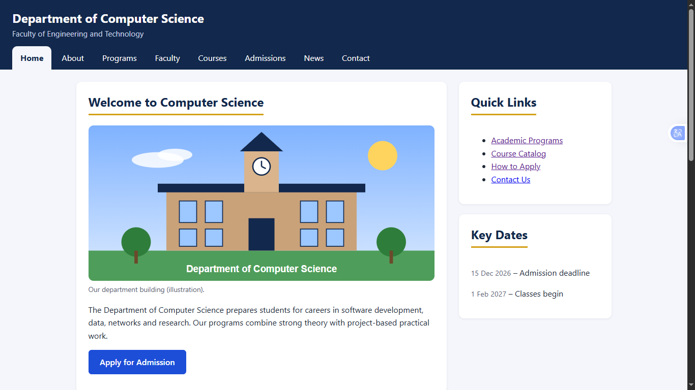
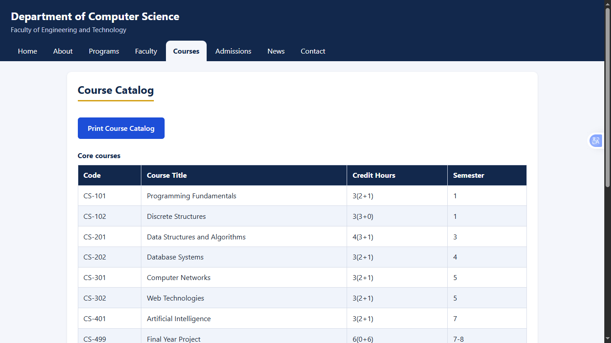
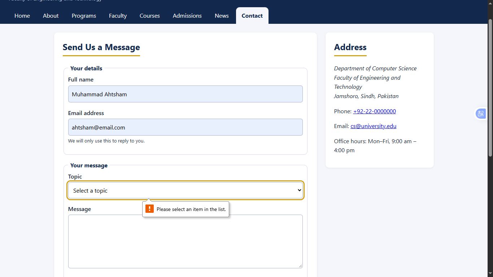

 
  
University Department Website

Computer Science Department website built with semantic HTML5 (Web Technologies Lab 2).

## Pages
Home, About, Programs, Faculty, Courses, Admissions, News, Contact.

## Run it
1. Copy the `department` folder into `C:\xampp\htdocs\`
2. Start **Apache** in the XAMPP Control Panel
3. Open http://localhost/department/

## What is included
- Semantic tags: `header`, `nav`, `main`, `section`, `article`, `aside`, `footer`
- Faculty table and course tables (`caption`, `thead`, `tbody`, `th scope`)
- Image with alt text (`assets/images/campus.svg`) and a `video` element (`assets/images/intro.mp4`)
- Map placeholder on the Contact page
- News page using `article` and `time`
- Course comparison table and accessible contact form (labels, fieldset, aria)
- Advanced: skip link, visible focus states, JSON-LD metadata (Home), print stylesheet for the course catalog

## Validation
Check each page at https://validator.w3.org/#validate_by_upload (upload the `.html` file).

## Screenshots to take for submission
1. Home page: http://localhost/department/
2. Faculty (or Courses) table
3. News page
4. W3C validator result ("Document checking completed. No errors or warnings to show.")
